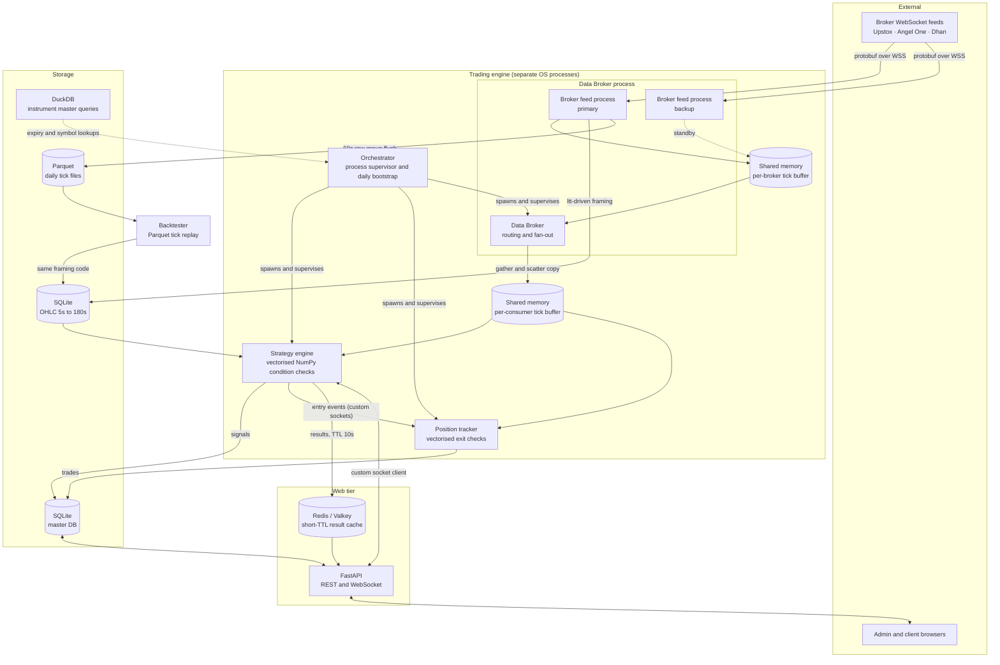
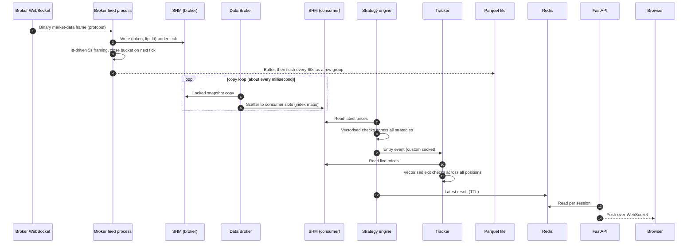

# TradeApp

**A tick-level, multi-process algorithmic trading platform for Indian index derivatives, built in Python.**

TradeApp ingests live market ticks from broker WebSocket feeds, frames its own sub-minute candles, evaluates hundreds of strategy conditions per tick using vectorised NumPy, tracks open positions, and exposes everything through a role-based web console. The same candle-framing code runs in live trading and in tick-level backtesting, so what you test is what you trade.

> This document describes the architecture, the technology choices and the reasoning behind them. Strategy logic, parameters and broker credentials are intentionally not part of this showcase.

---

## Table of contents

1. [Why this project exists](#1-why-this-project-exists)
2. [Architecture at a glance](#2-architecture-at-a-glance)
3. [Tech stack and why each piece was chosen](#3-tech-stack-and-why-each-piece-was-chosen)
4. [Components in detail](#4-components-in-detail)
   - [4.1 Orchestrator](#41-orchestrator)
   - [4.2 Data Broker and the broker abstraction](#42-data-broker-and-the-broker-abstraction)
   - [4.3 Tick transport with shared memory](#43-tick-transport-with-shared-memory)
   - [4.4 Custom candle framing](#44-custom-candle-framing)
   - [4.5 Tick storage: Parquet](#45-tick-storage-parquet)
   - [4.6 DuckDB](#46-duckdb)
   - [4.7 Strategy engine and vectorised condition checks](#47-strategy-engine-and-vectorised-condition-checks)
   - [4.8 Position tracker](#48-position-tracker)
   - [4.9 Custom socket server and client library](#49-custom-socket-server-and-client-library)
   - [4.10 Tick-based backtesting](#410-tick-based-backtesting)
   - [4.11 Web application: FastAPI, Redis, SQLite](#411-web-application-fastapi-redis-sqlite)
   - [4.12 Security and access control](#412-security-and-access-control)
5. [End-to-end data flow](#5-end-to-end-data-flow)
6. [Project layout](#6-project-layout)
7. [Testing](#7-testing)
8. [Deployment](#8-deployment)
9. [Disclaimer](#9-disclaimer)

---

## 1. Why this project exists

Short-horizon index-derivatives strategies are decided in seconds, not minutes. That puts demands on a system that most retail-grade tooling does not meet:

| Requirement | Why off-the-shelf tooling falls short |
|---|---|
| **Sub-minute candles** (5s, 10s, 15s ... 180s) | Broker historical/intraday candle APIs typically offer 1-minute as the smallest interval, are rate limited, and lag the live market. |
| **Many strategies evaluated on every tick** | Looping over strategies in pure Python becomes the bottleneck as the strategy count grows. |
| **Feed reliability** | A single broker WebSocket is a single point of failure during market hours. |
| **Trustworthy backtests** | Candle-based backtests hide intra-candle ordering and rarely match how live data is framed. |
| **Low-latency internal messaging** | Components must exchange ticks, signals and control messages without network-grade overhead. |
| **Multi-user operation** | Admins curate strategies; clients subscribe, paper-trade, and request live access under approval. |

TradeApp addresses each of these with a deliberately small set of purpose-built components rather than a large framework.

---

## 2. Architecture at a glance



**Control plane vs data plane.** Hot-path ticks travel through **shared memory** (no serialisation, no sockets). Everything else, such as control messages, subscription changes, entry events and token updates, travels over a **custom asyncio socket layer**. Keeping the two planes separate is the central design decision: the data plane is optimised purely for throughput and latency, the control plane for clarity and robustness.

---

## 3. Tech stack and why each piece was chosen

| Layer | Technology | Why this, and not something else |
|---|---|---|
| Language / runtime | **Python 3, asyncio, multiprocessing** | Fast iteration on strategy logic; `asyncio` for I/O-bound feeds and sockets; separate OS processes bypass the GIL for CPU-bound work. |
| Numerics | **NumPy** | Structured arrays for ticks, boolean masks and ufuncs for conditions. NumPy's compiled inner loops use CPU vector (SIMD) instructions, so condition checks over thousands of elements cost about the same as a handful. |
| Tick transport | **`multiprocessing.shared_memory`** | Zero-copy, zero-serialisation hand-off of the latest price per instrument between processes. |
| Tick persistence | **Apache Parquet via PyArrow** | Columnar, compressed, schema-carrying and append-friendly in row groups; ideal for write-once, read-many tick history. |
| Analytical queries | **DuckDB** | In-process SQL engine that queries CSV and Parquet in place, with no server and no import step. |
| Feed protocol | **WebSockets + Protocol Buffers** | Broker-native binary protocol. Decoded in-process with the broker's own `.proto` definitions. |
| Inter-process messaging | **Custom asyncio TCP socket server and client** | Exact semantics we need (push channel + request/response channel + heartbeats) with no native dependencies. See [4.9](#49-custom-socket-server-and-client-library). |
| Web framework | **FastAPI + Uvicorn + Gunicorn** | Async-native, Pydantic validation built in, first-class WebSocket support, simple production serving. |
| Operational database | **SQLite** | Zero-ops embedded relational store with foreign keys and constraints; the system runs on a single host, so a database server would add cost without benefit. |
| Cache / fan-out buffer | **Redis (Valkey compatible)** | Decouples the compute engine from the web tier with TTL-bound results. |
| Validation | **Pydantic v2** | Strategy definitions and API payloads are validated before they touch the database or the engine. |
| Auth / hardening | **JWT, bcrypt, SlowAPI, reCAPTCHA** | Stateless sessions, salted password hashing, per-IP rate limiting, bot protection on sign-up and login. |
| Packaging | **Docker, docker-compose** | Web tier and cache run as containers; non-root user inside the image. |
| Testing | **pytest** | 130+ unit tests across the tracker, signal manager, data broker and database layer. |

---

## 4. Components in detail

### 4.1 Orchestrator

The orchestrator is the process supervisor and daily bootstrap script.

**Start-of-day routine**
- Downloads the latest instrument master files from each supported broker.
- Computes the nearest option and future expiries per index, using DuckDB.
- Archives the previous day's trades, signals and logs into `historical_*` tables so the live tables start clean.
- Clears stale broker login flags so expired sessions are never reused.
- All of the above is idempotent: a date marker means a restart mid-day does not redo the work.

**Process topology**
- Spawns the **Data Broker**, then the **strategy engine**, then the **tracker**, in dependency order.
- Hands each consumer its own cross-process lock for its shared-memory buffer.
- Passes the broker access token to the Data Broker over the socket layer, so credentials never travel through process arguments or the filesystem.
- Aborts startup and cleans up child processes if the Data Broker is unreachable, rather than leaving half a system running.

**Why separate processes?** A crash or a long GC pause in the strategy engine must not stall the feed handler, and vice versa. Process isolation gives fault containment and true parallelism on multi-core machines.

### 4.2 Data Broker and the broker abstraction

The Data Broker sits between the broker feeds and everything that consumes prices. Strategies and the tracker never talk to a broker directly; they ask the Data Broker for instruments and receive prices from shared memory.

**Responsibilities**
- Runs one **feed process per broker** (Upstox, Angel One and Dhan adapters), each with its own WebSocket, retry policy, and shared-memory buffer.
- Maintains **per-broker symbol lookups** that translate each broker's instrument naming and numeric tokens into one **canonical instrument key**. Consumers see a single naming scheme regardless of which broker is live.
- Tracks which instruments each consumer wants, merges them, and forwards the union to the active broker as a subscription.
- Runs a tight **copy loop** that moves the latest prices from the primary broker's buffer into each consumer's buffer.

**Why a Data Broker with backup brokers?**

1. **Resilience.** A broker's market-data WebSocket can disconnect, throttle, or lag during volatile sessions. With adapters for multiple brokers behind one interface, the platform can serve the same canonical data from a different feed.
2. **Consumer isolation.** Because consumers only see the Data Broker's buffers, a broker switch is a change in *where the Data Broker copies from*. Strategy code and tracker code do not change and do not need to know a switch happened.
3. **Rate-limit and subscription management.** One component owns the subscription budget per broker instead of every consumer opening its own connection.
4. **Broker-specific quirks stay contained.** Login flows (OAuth, TOTP), token expiry, symbol formats and protobuf schemas differ per broker; they stay inside the adapter.

The message vocabulary already includes broker-switch and fault notifications. See [Status and roadmap](#9-status-and-roadmap) for what is automatic today and what is in progress.

### 4.3 Tick transport with shared memory

Every instrument has one slot in a NumPy **structured array** that lives in OS shared memory:

```
tick record = (instrument_id: int32, ltp: float64, timestamp: int64)
```

**Flow**
1. A broker feed process decodes a protobuf message and writes `(token, ltp, ltt)` into its slot under a lock.
2. The Data Broker takes the lock briefly, snapshots the buffer with a single `copy()`, and releases it.
3. For each consumer, it uses precomputed **index maps** and NumPy fancy indexing to gather from the snapshot and scatter into that consumer's buffer in one vectorised assignment.
4. The consumer reads its own buffer on its own schedule.

**Why shared memory instead of sockets or queues?**
- Prices are **latest-value state**, not a queue of events. A consumer that is briefly busy should see the newest price, not a backlog of stale ones.
- No pickling, no JSON, no kernel round trips on the hot path.
- Each consumer has its **own buffer and lock**, so a slow consumer cannot block the others, and consumers never contend with the broker writer.
- A per-consumer index map means each consumer pays only for the instruments it asked for.

### 4.4 Custom candle framing

TradeApp builds its own candles from raw ticks instead of calling a broker's candle or historical API.

**Why not use the candle API?**
- **Granularity.** Sub-minute candles (5s through 180s) are not generally offered.
- **Latency.** Polling a REST endpoint for "the latest candle" is slower and less deterministic than building it from the stream already in memory.
- **Rate limits.** Fetching candles for dozens of instruments on short intervals would exhaust API quotas.
- **Consistency.** Candles built from the same ticks the strategies see cannot disagree with them.
- **Replayability.** Own framing code can be pointed at recorded ticks, which makes backtesting exact (see [4.10](#410-tick-based-backtesting)).

**How framing works**
- **Exchange time, not wall-clock.** A candle's bucket is derived from each tick's *last traded time* (`ltt`). Network jitter and processing delay cannot move a tick into the wrong candle.
- **Close on the next bucket's first tick.** A candle closes the moment a tick arrives whose `ltt` belongs to a newer bucket, so there is no timer polling and no lookahead.
- **One base interval, many derived intervals.** Only the **5-second** candle is framed from ticks. 10s, 15s, 20s, 30s, 45s, 60s, 120s and 180s candles are **roll-ups of closed 5s candles**. Every one is an exact multiple of 5s, so this guarantees alignment between timeframes and avoids re-implementing gap handling nine times.
- **Out-of-order protection.** One WebSocket message can carry instruments with slightly different timestamps. Entries are sorted by `ltt` before framing, and ticks that belong to already-closed buckets are ignored. Time only moves forward.
- **Gap handling.** If no tick arrives for a few buckets, skipped buckets are closed in order and **forward-filled** so timestamps are never silently missing. Gaps beyond a cap (5 minutes) are treated as a session boundary instead of manufacturing a long run of synthetic candles.
- **Scope control.** Option contracts are excluded from framing; only the instruments that need candles pay for them.

Completed candles are written to per-interval SQLite tables (`ohlc_5s` ... `ohlc_180s`) at the moment they close.

### 4.5 Tick storage: Parquet

Every live tick is also persisted for later replay and research.

**Layout: wide format, one file per trading day**

```
timestamp_ms | <token_A> | <token_B> | ... | <token_A>_ltt | <token_B>_ltt | ...
-------------|-----------|-----------|-----|---------------|---------------|----
1710123456001|  182.50   |  415.20   | ... | 1710123455000 | 1710123456000 | ...
```

- Ticks are buffered in memory and **flushed every 60 seconds** on a wall-clock boundary, pivoted to wide format and appended as a **new row group**.
- The Parquet **schema metadata** stores the token-to-symbol and index maps, so a file is **self-describing**: it can be replayed years later without the original lookup files.
- Each instrument gets a price column and a last-traded-time column, so replays can use the exchange timestamp, not just the arrival timestamp.
- The writer rotates at midnight; the flush runs off the event loop in an executor so disk I/O never delays tick handling.

**Why Parquet rather than CSV, SQLite, or a time-series database?**
| Concern | Parquet's answer |
|---|---|
| Size | Columnar layout with compression; tick data (highly repetitive prices) compresses very well. |
| Read speed | Column pruning (read only the instruments you need) and row-group streaming (never load a full day into RAM). |
| Write pattern | Append-only, batched writes match how ticks arrive; no index maintenance or write amplification. |
| Typing | Explicit schema, with `int64` timestamps and `float64` prices. No parsing ambiguity. |
| Ecosystem | Readable by PyArrow, pandas, DuckDB, Polars, Spark. No lock-in. |
| Ops | A day of data is just one file you can copy, archive, or delete. |

### 4.6 DuckDB

DuckDB is an **in-process analytical SQL engine**: no server to run, and it queries files directly.

**Where it is used today:** the daily bootstrap uses DuckDB to run SQL directly over the brokers' large instrument master CSV files (`read_csv_auto`) to compute distinct, sorted option and future expiries per index. It replaces loading hundreds of thousands of rows into pandas just to extract a few dates.

**Why it fits the project's shape:** the same engine can run SQL straight over the daily tick Parquet files for ad-hoc research (for example, per-instrument aggregates or session statistics) without an import step. Parquet for storage plus DuckDB for querying keeps the analytics layer free of database servers.

### 4.7 Strategy engine and vectorised condition checks

The strategy engine consumes candles and live prices and decides when a configured strategy's conditions are satisfied.

**The problem:** an admin may configure many strategies, each with several conditions over several timeframes. Evaluating them with nested Python loops scales linearly in interpreter overhead.

**The approach: structure-of-arrays plus boolean masks**
- Per-strategy thresholds are held in **NumPy arrays**, one element per strategy.
- Computed metrics for the current candle are placed in a matching array.
- A single expression such as `np.all(computed > thresholds)` or `np.any(trigger_mask)` evaluates **every strategy at once**.
- "This condition is not used by this strategy" is encoded as a **mask array**, so there are no branches in the hot loop. Disabled conditions are simply masked out.

**Why this is fast: SIMD**
NumPy's ufuncs (comparison, `where`, `minimum`, `maximum`, arithmetic) run in compiled C loops that dispatch at runtime to the best CPU vector instruction set available (SSE, AVX2, AVX-512, or NEON on ARM). One instruction compares several float64 values at once, and the Python interpreter is entered once per *batch* of strategies rather than once per strategy. Adding strategies grows array length, not interpreter work.

We do not hand-write intrinsics; the point is to **shape the problem so that the library's vector kernels do the work**.

**Other engine design points**
- **Warm-up awareness:** conditions that need history are suppressed until enough candles exist.
- **Result cache:** computed results are pushed to Redis with a short TTL for the web tier (see [4.11](#411-web-application-fastapi-redis-sqlite)).
- **One engine per index:** each traded index runs in its own process on its own port.
- **Pydantic-validated configuration:** strategy definitions are validated (allowed timeframes, directions, ranges) before being stored or loaded.

### 4.8 Position tracker

Once a strategy fires, the tracker owns the trade lifecycle: selecting the instrument, entering, monitoring, and exiting.

It uses the **same vectorised pattern** as the strategy engine, applied to open positions:

- Stop-loss levels, trailing stops, targets and their override rules for every live trade live in **parallel "master" arrays**, each with an **activity mask**.
- Running highs and lows used by trailing logic are maintained with `np.where` / `np.minimum` / `np.maximum` over the whole array in one step.
- Each exit family (fixed stop, trailing stop, targets, reversal-based exits and so on) is one vectorised check that returns a boolean array; `np.any` is a cheap early-out, and `np.where(trigger)[0]` extracts exactly which trades fired.
- Positions are activated and deactivated by flipping mask entries and reusing slots, so arrays do not constantly reallocate.

**Fault tolerance:** long-running tasks are created through a small supervisor that can restart a crashed task by name, so one failed coroutine does not take the tracker down. Writes that touch shared files use file locks.

### 4.9 Custom socket server and client library

Rather than adopting a message-queue library such as ZeroMQ, TradeApp ships its own small asyncio socket layer (`SocketServer` and `SocketClient`, a few hundred lines of pure Python).

**Wire format:** a 4-byte big-endian length prefix followed by a JSON payload over localhost TCP. `readexactly` on the receive side makes framing trivial and robust against partial reads.

**Two channel types, deliberately separate**

| | **Open channel** | **Request channel** |
|---|---|---|
| Lifetime | One long-lived connection per client name | One short-lived connection **per request** |
| Direction | Server to client pushes, broadcasts, client messages | Exactly one request and one response, then closed |
| Liveness | Ping/pong heartbeat in both directions, with timeouts | Per-call timeout |
| Depends on the other? | No | No |

Every message carries a `_channel` tag, so a push can never be mistaken for the reply to a request, which is a classic bug in single-socket designs.

**Built-in robustness**
- **Heartbeats** on open channels. A missed pong marks the peer dead; the connection is torn down and a cleanup callback fires **exactly once**.
- **Per-client request serialisation** with an `asyncio.Lock` keyed by client name, so concurrent requests from one component cannot interleave.
- **Send timeouts** on `drain()` so a stuck peer cannot wedge the sender.
- **Broadcast** and **targeted push** helpers for fan-out of events such as "data ready" and "new maps".
- Integer **message types** form a compact protocol vocabulary (connection creation, instrument requests, broker switch, strategy updates, entry events, trade-completed, fault, and so on).

**Why not ZeroMQ (or similar)?**
This is a design choice about fit, not a claim that ZeroMQ is deficient in general:

1. **Request/response and push in one coherent model.** ZeroMQ expresses these as different socket patterns (REQ/REP, PUB/SUB, DEALER/ROUTER) with their own state machines. REQ/REP enforces strict alternation, and PUB/SUB gives no delivery guarantee to late joiners. We wanted two simple primitives with exactly the semantics above.
2. **Liveness and cleanup hooks at the application level.** We needed "peer X is gone, run this cleanup once" as a first-class event tied to our own component names, and not inferred from socket states.
3. **Native dependency.** The layer is pure standard-library asyncio. There is nothing to compile and nothing platform-specific to install, which matters because development and production span Windows, WSL and Linux containers.
4. **Native asyncio integration.** It runs on the same event loop as the rest of each component, without a separate I/O thread or polling bridge.
5. **Observability and debuggability.** Messages are readable JSON with a tiny framing header; any message can be inspected or replayed with a few lines of code.
6. **Right-sized.** All traffic is local and low-volume (control messages, not ticks), so a brokerless library's throughput features are unnecessary. The ticks themselves go through shared memory.

### 4.10 Tick-based backtesting

**How it works**
1. A recorded day's Parquet file is streamed **row group by row group** (never fully loaded).
2. Each row is replayed through the **same ltt-driven framing logic** used live: same buckets, same gap handling, same out-of-order rejection, same derived roll-ups.
3. Candles are written to SQLite **as each bucket closes, with no lookahead**.
4. The strategy engine runs over those candles exactly as it does live.

**Why tick-based rather than candle-based backtesting?**
- **Fidelity.** Candle backtests have to guess the order of events inside a candle (did the stop or the target hit first?). Ticks remove the guess.
- **Parity.** Because live and replay share the framing code, a candle in a backtest is the candle that would have existed live. There is no second implementation to drift out of sync.
- **Any timeframe, any time.** Because raw ticks are stored, new candle intervals can be tested retroactively without re-collecting data.

**Why it is fast**
- Replay is **not paced to the wall clock**; it runs as fast as the CPU can process rows.
- Parquet column pruning and row-group streaming keep memory flat and I/O small.
- Optional time-slice filters let you replay just the window you care about.

### 4.11 Web application: FastAPI, Redis, SQLite

**FastAPI**
- Server-rendered pages (Jinja2) with vanilla-JS front ends for the admin console, client dashboard, signals, trades, reports and strategy management.
- REST endpoints for CRUD on strategies, groups, users, permissions and logs; a **WebSocket endpoint** that pushes live streams to the browser.
- Pydantic models validate every request body.
- Served by Gunicorn with Uvicorn workers in the container.
- Broker OAuth callbacks (login/redirect flows) are handled here, and access tokens are forwarded to the engine over the custom socket layer.

**Redis (or Valkey)**
- The strategy engine writes its latest computed result per user session with a **short TTL**; the WebSocket task for that session reads it back and pushes it to the browser.
- This **decouples** the compute process from the web tier: the web tier never calls into the engine on the hot path, and stale data expires on its own instead of being served silently.
- Connections use short socket timeouts so a cache hiccup cannot freeze the engine.

**SQLite (master database)**
- Strategies and groups, users and pending sign-ups, per-user strategy subscriptions, signals, trades, analytics logs, and broker-credential tables.
- Relational integrity with foreign keys and cascading deletes, `UNIQUE` constraints to prevent duplicate strategies/signals/trades, and `CHECK` constraints on flags.
- Strategy and trade payloads are stored as JSON but **validated by Pydantic before insert**.
- Tuned for the workload: foreign keys enforced, a busy timeout for concurrent writers, and a large page cache so hot OHLC pages stay in memory.
- Log tables are append-only and archived daily into `historical_*` tables.

**Why SQLite?** The system runs on one machine; SQLite gives real SQL, constraints and transactions with no server to operate, back up, or secure separately. The trade-off is single-host scaling, which is acceptable for the current deployment model.

### 4.12 Security and access control

- **Authentication:** bcrypt-hashed passwords; JWT sessions with expiry; role claims (admin / client) enforced on every protected route.
- **Abuse protection:** per-IP rate limiting (SlowAPI) and reCAPTCHA on sign-up and login.
- **Onboarding workflow:** new accounts land in a **pending** table and become real users only after admin approval.
- **Two-layer permission model:**
  - *Groups* let admins grant or revoke whole sets of strategies in bulk.
  - *Per-strategy subscriptions* give individual paper/live flags.
- **Paper vs live gating:** paper trading is self-service; **live trading requires an explicit client request and admin approval**, with timestamps for both.
- **Secrets hygiene:** secrets come from environment variables, are never logged, and credentials tables are isolated from the trading schema.
- **Container hardening:** the image runs as a non-root user.

---

## 5. End-to-end data flow



---

## 6. Project layout

```
TradeApp/
├── src/tradeapp/
│   ├── orchestrator.py          # process supervisor and daily bootstrap
│   ├── app.py                   # FastAPI application (REST, WebSocket, auth)
│   ├── broker_files/
│   │   ├── databroker.py        # Data Broker: routing, fan-out, symbol maps
│   │   ├── fetch_*_ticker.py    # per-broker feed adapters
│   │   └── save_*_ticker*.py    # tick-to-Parquet persistence
│   ├── strategies/              # strategy engine and standalone test harnesses
│   ├── trading_engine/
│   │   ├── signals_manager.py   # vectorised condition evaluation
│   │   └── tracker.py           # position lifecycle and vectorised exits
│   ├── utils/
│   │   ├── socket_handler.py    # custom socket server and client
│   │   ├── database_handler.py  # SQLite data-access layer
│   │   ├── update_instruments.py# instrument master and DuckDB queries
│   │   └── logging_config.py
│   ├── debug/                   # tick replay, tick-to-OHLC, chart tools
│   ├── config/                  # constants, schemas, message types
│   ├── templates/  static/      # Jinja2 templates and front-end assets
├── tests/                       # pytest suite
├── docs/database.md             # schema reference
├── Dockerfile
└── docker-compose.yaml          # web tier and Redis
```

---

## 7. Testing

The repository includes **130+ pytest unit tests** covering the position tracker, signal manager, Data Broker, database handler, price-action engine and tick feed handling. Additionally:

- A **mock broker mode** lets the Data Broker and engine run end-to-end without a live feed.
- Standalone strategy test harnesses allow fast local iteration on a single index.
- Replay-based runs (see [4.10](#410-tick-based-backtesting)) double as regression tests for the framing logic.

```bash
pip install -r requirements.txt -r requirements-dev.txt
pytest
```

---

## 8. Deployment

**Web tier and cache (containers)**

```bash
docker build -t tradeapp:latest .
docker compose up -d        # FastAPI on :5001 (container :7000) + Redis
```

Required environment variables (see `.env.example`): admin username, application secret key, cache password, reCAPTCHA secret.

**Trading engine (host process)**

```bash
python -m src.tradeapp.orchestrator
```

The orchestrator performs the daily bootstrap, starts the Data Broker, strategy engine and tracker, and begins serving control messages.

**First-time setup:** initialise the admin credentials in the `users` table, then add the data-collection account's broker credentials to the matching `<broker>_api_info` table.

---

## 9. Disclaimer

This project is shared for engineering and educational purposes. It is not investment advice and carries no warranty. Trading derivatives involves substantial risk of loss. Strategy definitions, parameters and credentials are not included in this repository.

---
